<p align="center">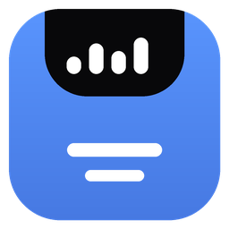</p>

<h1 align="center">Nock</h1>

<p align="center">A tiny, native Windows <b>dynamic island</b> and <b>macOS-style menu bar</b>.<br>
Written in Rust. No webview, no framework, no runtime. One small <code>.exe</code>, or a tiny installer.</p>

<p align="center">
<a href="https://github.com/Akhilesh-Varute/Nock/actions/workflows/ci.yml"></a>
<a href="https://github.com/Akhilesh-Varute/Nock/releases/latest"></a>


</p>

<p align="center">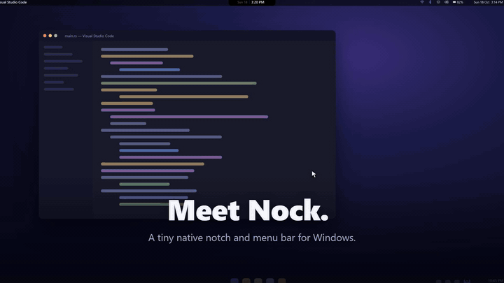</p>

> **Status: early.** It builds in CI and works on the author's machine, but has had limited testing elsewhere. Expect rough edges and please [open an issue](../../issues).

## Features

- **Notch / dynamic island** at the top centre. Click it and a panel opens with tabs: **Media**, **Controls**, **Today** (focus timer, to-dos, calendar), **Stats**, **Clipboard**, **Apps**, **Games** and **Power**.
- **Top bar** like the macOS menu bar: active app name, Wi-Fi, Bluetooth, sound, brightness, battery and clock, each with a dropdown (join Wi-Fi networks, connect Bluetooth devices, sliders, calendar). Optional clock styles and a CPU / memory read-out.
- **A little life**: a buddy character on the bar, scripted scenes, an arcade with four mouse-only games, and small reactions on the pill (squish on click, glow with the music, confetti when the timer ends).
- **Gentle reminders** (all off by default): drink water, and look away from the screen (20-20-20).
- **Zero idle cost**: event driven, no polling loop; about 0% CPU and about 32 MB of memory while idle (see [Why it is light](#why-it-is-light)). Hides itself in full-screen video and games, with a top-edge reveal.
- Follows the Windows light/dark theme.

## Install

Download **`NockSetup-<version>.exe`** from the [latest release](../../releases/latest) and run it. It installs just for you (no admin rights), adds Nock to the Start menu so you can find it by searching "Nock", and can start it with Windows. Uninstall it from Windows Settings → Apps like any other app.

Prefer no installer? The same release also has the plain **`nock.exe`**: put it in a folder you will keep and run it. (Nock adds its own Start menu shortcut when it runs, so search finds it either way; tray → *Show in Start menu and search* turns that off.)

Right-click the tray icon → **Start with Windows** to launch it at login.

**Updates:** right-click the tray icon → **Check for updates**. If a newer release exists Nock offers to update; for a copy installed with the installer it downloads the new installer, runs it silently and restarts itself. A plain `nock.exe` just opens the download page. It only checks when you click, never in the background.

## Build

1. Install Rust from <https://rustup.rs> (choose the default **MSVC** toolchain). If asked, also install the Visual Studio Build Tools with the "Desktop development with C++" workload (this includes the Windows SDK, which embeds the exe icon).
2. In this folder run:

   ```
   cargo build --release
   ```

   (or double-click `build.bat`)
3. Run `target\release\nock.exe`. It is a single self-contained file. Copy it anywhere.

To build the installer yourself, install [Inno Setup 6](https://jrsoftware.org/isinfo.php) and run `ISCC.exe /DMyAppVersion=1.2.3 installer\nock.iss` after the release build. The release workflow does this on every version tag.

## Tip: auto-hide the Windows taskbar

Nock works best with the Windows taskbar set to hide itself. The bar and notch then take over the top of the screen, the taskbar slides up only when you move the pointer to the bottom edge, and the whole screen feels like one clean desktop.

Settings → Personalization → Taskbar → Taskbar behaviors → **Automatically hide the taskbar** (on Windows 10: right-click the taskbar → Taskbar settings → *Automatically hide the taskbar in desktop mode*).

## Using it

| Action | What happens |
| --- | --- |
| Click the pill | Opens the panel |
| Move the mouse away | Panel closes after a short delay |
| Pin icon (top-left of panel) / `Ctrl+Alt+N` | Keeps it open until you collapse it |
| Chevron (top-right) | Collapses it |
| `Ctrl+Alt+T` | **Quick add**: opens the notch straight into the to-do box. Enter saves, Esc cancels, and it closes again |
| Mouse wheel over the pill | Scroll down opens it |
| Mouse wheel over the tab row | Switches pages |
| `Ctrl+Alt+H` / tray → *Hide notch* | Tucks the notch away completely; press again (or `Ctrl+Alt+N`, or click the tray icon) to bring it back |
| Tray icon | All the settings below |

The pill itself reacts: it squishes when you click it, jiggles when the pointer arrives, glows with the music (following the real output level), gives a heartbeat flash when you copy a link, and bursts into confetti when the focus timer ends.

### Pages (tab row at the top)

- **Media**: artwork, title, artist, source app, seekable progress bar, previous / play-pause / next. Reads Windows' own media session, so it works with Spotify, YouTube and other browser media, VLC, Apple Music and so on. While music plays, the collapsed pill shows the artwork, track and equaliser bars.
- **Controls**: shortcuts to **Screenshot** (Snipping Tool) and the Windows Settings pages people look for: **Display**, **Sound**, **Network**, **Power & battery** and **All settings**. (Wi-Fi, Bluetooth, volume and brightness are in the top bar.)
- **Today**: three cards.
  - *Focus timer*: 5 / 15 / 25 / 50 minute presets, or the pencil to type any number of minutes. Hover a to-do and click its ▶ to start a session on that task (the timer shows the task's name). A line under the timer shows today's focus minutes and tasks done. With *Auto break after focus* on (tray), a 5 minute break follows each session, then focus again. When a timer finishes you get three beeps, confetti, and the pill pulses "Time's up" for 30 s (or until you click it); the Quidditch scene celebrates if scenes are on.
  - *To-do*: a 5-item list, saved to disk.
  - *Calendar*: the current month.
- **Stats**: CPU and memory ring gauges (with a CPU history), battery with charging state, and uptime. It samples once a second, only while this tab is open.
- **Clipboard**: the last 20 things you copied. Click one to paste it into the app you were using. **Star** an item to pin it: pinned items stay at the top, survive "Clear" and restarts, and work as saved snippets. **Search** filters the list as you type (Enter keeps the filter, Esc clears it). Recent history lives in memory only, and copies from password managers are skipped; only the items you pin are written to disk.
- **Apps**: pinned launcher tiles with the real app icons. Click **+ Add app** to pick from every installed app (Start menu apps, Store apps, game launchers) with a search box; click an app to pin it, and use the small **×** on a tile to unpin. The list refreshes each time you open the picker, and has a refresh button. Up to 12 tiles.
- **Games**: pick one on the arcade screen; all are mouse only and each keeps a best score.
  - *Super Flight*: click to flap through the pipes.
  - *Brick Breaker*: move the mouse to steer the paddle, click to launch; power-ups, levels and combos.
  - *Slicer*: swipe the mouse fast through flying fruit, avoid the bombs.
  - *Viking Run*: click to jump, click again in the air to double jump, hold to jump higher.
- **Power**: Lock, Sleep, Restart and Shut down. Restart and Shut down ask for a second click within a few seconds.

## Top bar

A thin translucent bar runs along the top of the screen (like the macOS menu bar) and the notch hangs from its middle. Left: the app you are in. Right: Wi-Fi, Bluetooth, volume, brightness, battery and the date and time. Clicking an icon opens a small dropdown right under it:

- **Wi-Fi**: on/off switch, nearby networks with signal strength (the connected one marked). Click a saved network to join it, click the connected one to disconnect. A new password-protected network asks for its password right in the dropdown (paste works); an open network joins directly. Enterprise networks open Windows' own Wi-Fi settings.
- **Bluetooth**: on/off switch, paired devices (connected ones marked). Click a device to connect or disconnect it. Pairing new devices is done in Windows' Bluetooth settings (linked).
- **Sound**: volume slider and mute. It controls whichever output device is the default right now (speakers, Bluetooth, monitor).
- **Display**: brightness slider (laptop panels; always shown).
- **Battery**: percentage, charging state, time left, battery saver, link to battery settings.
- **Date and time**: month calendar with today highlighted.

**Connecting feedback:** while a Wi-Fi or Bluetooth connection is in progress the bar icon pulses and the row shows a spinner. When it finishes a small note says "Connected to …" or "Couldn't connect …".

**Hover tooltips:** resting the pointer on the Wi-Fi or Bluetooth icon shows what is connected (network name and signal; connected Bluetooth devices) without clicking.

**Clock style** (tray → *Clock style*): digital (default), analog, binary, or "hours until Friday".

**CPU and memory** (tray → *CPU and memory on the bar*): a small `CPU 12%  RAM 63%` read-out, off by default.

A dropdown closes when the pointer leaves it, when you click into another window, or when you click its icon again. The bar follows the Windows light/dark setting; the notch itself always stays black. It reserves its space like the taskbar does, so maximised windows start below it. Tray → *Top bar* turns it off (the old notch-only behaviour returns); `top_bar` in `config.ini` does the same.

### Reminders

Both are off by default and set from the tray menu. When one fires, your buddy says it and, if the notch is closed, the pill pulses a message.

- **Water reminder**: every 30, 45, 60 or 90 minutes.
- **Look-away reminder**: every 20, 30 or 45 minutes ("look at something far away for 20 seconds").

## Windows says "Smart App Control blocked an app"

Nock is not code-signed yet, so Windows 11 machines with **Smart App Control** switched on refuse to run it (the app is safe; Windows only blocks programs from publishers it doesn't know). Machines where it is off, which is most of them, only show the usual SmartScreen note ("Windows protected your PC"): click **More info → Run anyway**. If Smart App Control is on, you can turn it off in Windows Security → App & browser control → Smart App Control settings, or build and run in a different environment. You can read all of the source here before running anything.

## Buddy

A tiny original character lives on the top bar, in the free stretch between the notch and the status icons. It naps most of the time and wakes up for short outings, so it costs almost nothing:

- **Strolls** along the bar every minute or so, then goes back to sleep.
- **Dances** when music starts playing.
- **Follows your pointer** when you move it over that part of the bar, and its eyes follow the cursor. Click it to pet it.
- **Cheers** when the focus timer ends, and says "Connected!" or "Oops" after a Wi-Fi / Bluetooth attempt, "Low battery" when the battery runs low, "Bedtime?" late at night, and your reminders.

Pick the character from the tray menu → **Buddy**: Robot (default), Kitty, Blob, Bunny or Hero, or Off. It is also the `buddy` setting in `config.ini` (0 = off, 1 blob, 2 cat, 3 bunny, 4 hero, 5 robot, 6 ronin, 7 courier, 8 necromancer). The characters are drawn from simple shapes in code, so there are no image files. It hides together with the bar in full screen.

### Pixel characters

Three more characters are drawn as detailed pixel art and **talk** in character as they stroll: **Ronin** (a rain-worn samurai: "Patience.", "One cut."), **Courier** (a neon hoverboard runner: "Delivery's late. Again.") and **Necromancer** ("Death is a pause."). Pick them in the tray menu → **Buddy**. They also star in some of the scenes below.

### Scenes

The first scene plays a minute or two after Nock starts, then one every few minutes (about every 5 by default; set `scene_min=` in `config.ini`), when there is room on the bar: the characters act out a short scripted story and then walk off while your buddy comes back. Each one is a random pick that never repeats the last, and only scenes that fit the free space are chosen. Play one right away from the tray menu → **Scenes**, or turn the automatic ones off there (`scenes=0` in `config.ini`). Nothing runs between scenes.

<table>
<tr>
<td align="center">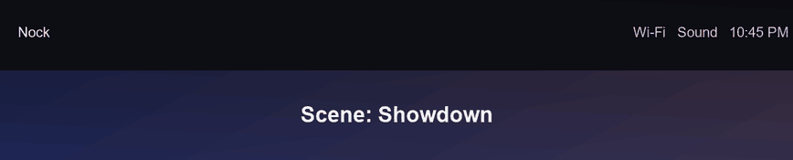<br><sub>Showdown</sub></td>
<td align="center">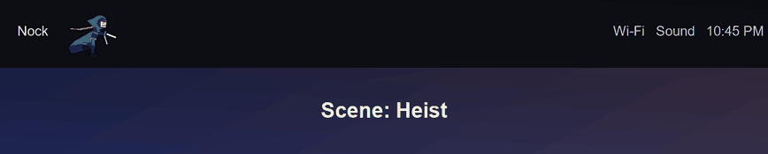<br><sub>Heist</sub></td>
</tr>
<tr>
<td align="center">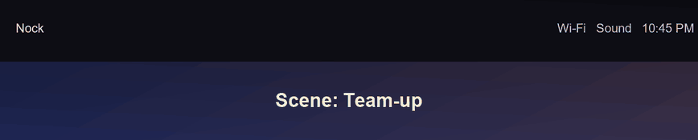<br><sub>Team-up</sub></td>
<td align="center">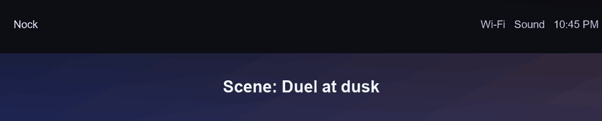<br><sub>Duel at dusk</sub></td>
</tr>
<tr>
<td align="center">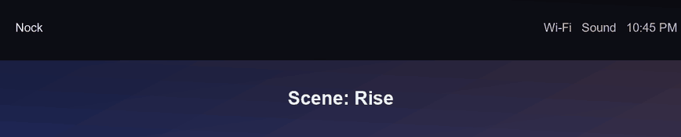<br><sub>Rise</sub></td>
<td align="center">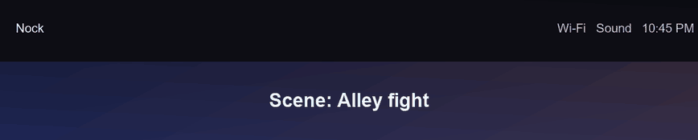<br><sub>Alley fight</sub></td>
</tr>
<tr>
<td align="center">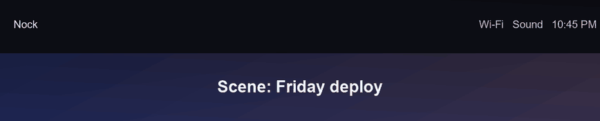<br><sub>Friday deploy</sub></td>
<td align="center">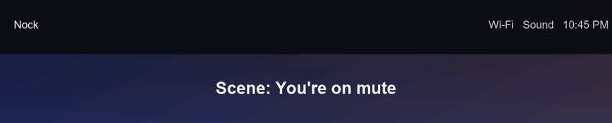<br><sub>You're on mute</sub></td>
</tr>
<tr>
<td align="center">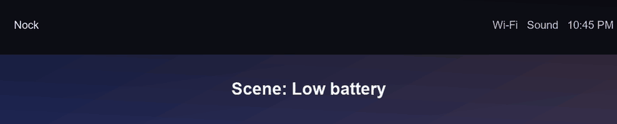<br><sub>Low battery</sub></td>
<td align="center">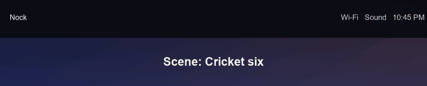<br><sub>Cricket six</sub></td>
</tr>
</table>

*(The clips are rendered from the scene code, a few at real speed, on a mock bar; the real thing plays on your actual top bar.)*

- **Original characters**: *Showdown* (Cinder the ember knight vs Krag the obsidian brute), *Heist* (Veil the shadow thief vs Sparkplug the young inventor), *Team-up*, *Duel at dusk* (Ronin vs Courier), *Rise* (Necromancer vs Ronin) and *Alley fight*.
- **Everyday jokes**, with their own everyday cast (a hoodie-wearing developer, a manager, support and intern colleagues, a very angry bug, cricketers and a fan): *Friday deploy* (the dev ships anyway, the bug shows up), *You're on mute* (the manager presents to nobody), *Low battery* ("1%... I can make it") and *Cricket six* (the bowler bowls, the batter hits it out of the bar).
- **Press conference**: a bobblehead answers a crowd of reporters with mics and a camera (needs about 420 px of free bar).
- **Wizard-school fan art**: *Harry vs Voldemort*, *Owl post*, *Harry and friends vs Voldemort*, *Quidditch* and *Dementor*.

### Fan art and images

The wizard-school scenes and the Thor, caped-flyer and other characters in the arcade are **unofficial fan art** drawn from simple shapes, not affiliated with or endorsed by their owners; all names and trademarks belong to their respective rights holders. The press conference scene uses a small photo cut-out bundled in `assets/face.png`. If you hold rights to anything in this repository and would like it changed or removed, please [open an issue](../../issues).

## Icon

The exe carries its own icon and file details (`assets/notch.ico`, embedded by `build.rs`), so Explorer, the taskbar and the Start menu show Nock instead of the generic Windows icon. The tray icon is `assets/icon.png`, compiled into the exe.

## Files and settings

Everything is in `%APPDATA%\Nock\` (tray → *Open settings folder*). Most settings are in the tray menu; `config.ini` holds them too:

- `config.ini`: `hover_expand` (open on hover instead of click), `eq_animation` (animate the equaliser bars), `clock_24h`, `reserve_space` (keep a thin strip at the top so maximised windows sit below the notch), `top_bar`, `buddy`, `scenes`, `scene_min`, `stats` (CPU/RAM on the bar), `clock_style` (0 digital, 1 analog, 2 binary, 3 until Friday), `water_min` and `eye_min` (minutes between reminders, 0 = off), `auto_break`, `start_menu` (the Start menu shortcut), `fs_hide` (hide while a full-screen app or game is in front; also in the tray as *Hide in full-screen apps*), and `auto_close` (close the open panel when the pointer leaves it or another window comes to the front; tray: *Close the panel when the pointer leaves*).
- `apps.txt`: pinned launcher entries, one per line: `Name|target|optional arguments`. The Apps tab edits it for you (+ and ×), but you can edit it by hand too: the target can be an exe, folder, URL or `ms-settings:` link. After editing, use tray → *Reload pinned apps*.
- `todos.txt`: the to-do list.
- `pinned_clips.txt`: the clipboard items you starred.
- `focus_today.txt`: today's focus minutes and finished tasks (resets each day).
- `games_best.txt`: best scores of the four games.
- `brightness.log` and `scene.log`: only written if a brightness change or a scene fails to start, with the reason.
- `visibility.log` also notes when the panel closed because another window came to the front.
- `visibility.log`: written when Nock hides itself because it thinks a full-screen window is in front (class, size and style of that window), so "it hides for no reason" can be diagnosed.

## Why it is light

**What that means in numbers** (measured with Task Manager-style counters on a Windows 11 laptop, notch collapsed, nothing playing, build 0.8.x):

| | Nock |
|---|---|
| CPU while idle | **0.0%** (readings between 0.00% and 0.3% over 20 s) |
| Memory (private) | about **32 MB** (about 60 MB working set, which also counts shared Windows DLLs) |
| Threads / handles | 21 / about 600 |
| Download | **about 1 MB** exe |

It is a native Rust program with no web view and no background polling, so it avoids the browser engine (typically a few hundred MB) that Electron-style widgets carry. It is not a benchmark against any specific app, and numbers go up briefly while you use it: the panel redraws as you hover, an animated scene or game uses a little CPU while it plays, and Stats samples once a second while that tab is open. You can check your own numbers in Task Manager → Details → `nock.exe`.

- **Zero work while idle.** The process blocks in `GetMessage()`. There is no polling loop anywhere.
- Timers exist only while needed: a ~60 fps animation timer only during expand/collapse and the small pill reactions; a 20 fps timer only for the equaliser bars and glow while music plays and the pill is collapsed; a 1 Hz timer only while the Stats tab is open, a focus timer runs, or the panel is open on a playing track; a 60 fps timer only while a game is being played; and a 3 s timer only if you turned on the CPU/RAM read-out. Reminders and the clock use single long timers.
- Now-playing, clipboard changes, foreground-window changes and hotkeys are all event driven (WinRT events, `WM_CLIPBOARDUPDATE`, `SetWinEventHook`).
- The bar and notch hide while a game or full-screen video/browser is active. During a full-screen video or browser (not games) you can bring them back by resting the pointer on the top edge near the middle of the screen; they slide away again once you move down. While that is active the app watches the pointer position with a tiny system hook that exists only during full screen.
- Drawing is Direct2D into a small bitmap, only the size of the current pill/panel, pushed to a per-pixel-alpha layered window. Artwork is decoded once per track.
- One long-lived background thread (the media session) plus short-lived ones for Wi-Fi, Bluetooth and app-list lookups that exit when done. Release profile uses LTO, one codegen unit and `panic=abort`.

## Known limits

- Primary monitor only.
- Nock's windows have no title and are tool windows, so window pickers (OBS, screen recorders, Alt-Tab) should not list them. They still appear in full-screen / display captures, because they are drawn on the desktop.
- Media controls only do what the playing app allows through Windows. Apple Music for Windows, for example, does not let other programs seek, so its progress bar is display-only, and its Previous button is greyed out whenever the app reports it as unavailable.
- Wi-Fi and Bluetooth buttons in the top bar toggle the radio through the Windows Radios API. If Windows exposes no such radio (or denies access) the button opens the matching Settings page instead.
- Brightness on laptop panels is set through the display driver directly (instant, follows the slider as you drag). If the driver does not offer that, it falls back to a slower WMI call through PowerShell.
- The volume slider follows the Windows default output device. Apps routed to a different device under Settings → Sound → Volume mixer aren't affected.
- *Sleep* uses the standard suspend call; if hibernation is enabled on your PC Windows may hibernate instead.
- The calendar shows the month only (no events). There is no weather or notification peek.
- The games are mouse only, because the notch never takes keyboard focus from your other apps. The to-do, search and timer boxes take typed characters only (no IME composition).
- Game sounds are simple system beeps.
- The installer and exe are not code-signed (see the SmartScreen note above).

## Contributing

Issues and pull requests are welcome, see [CONTRIBUTING.md](CONTRIBUTING.md). Looking for something to work on? See [GOOD_FIRST_ISSUES.md](GOOD_FIRST_ISSUES.md). Version history is in [CHANGELOG.md](CHANGELOG.md).

## License

[MIT](LICENSE)
